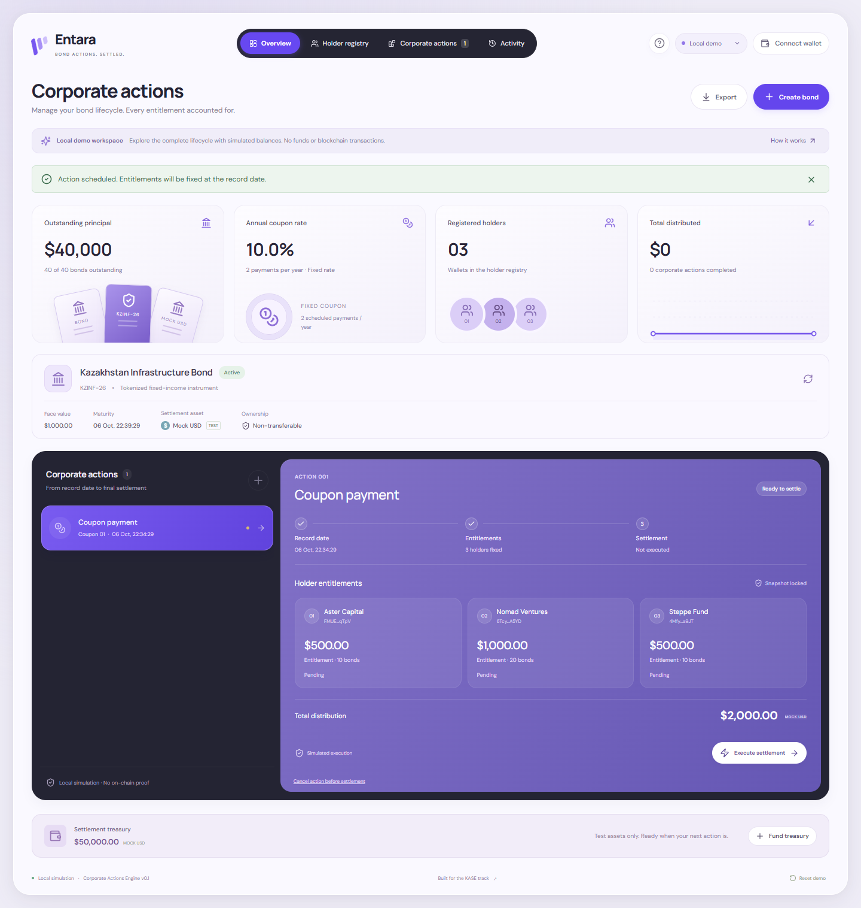
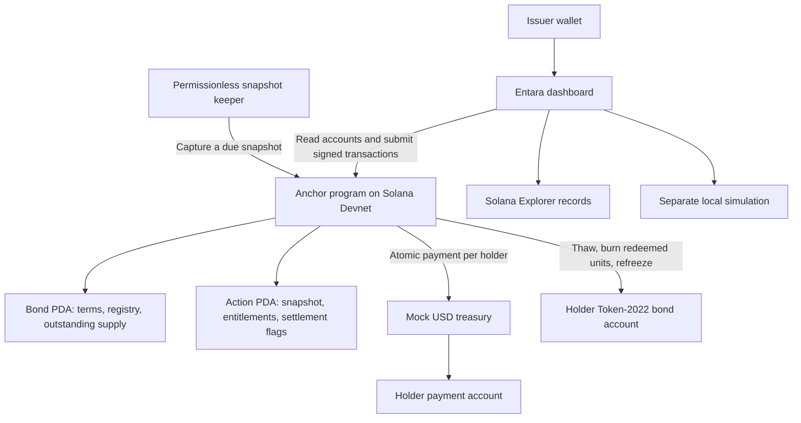

# Entara — Bond Actions. Settled.

> A corporate actions workspace for tokenized bonds on Solana: issue bonds, fix holder entitlements, pay coupons, and execute early or maturity redemptions with verifiable on-chain records.

[Live Demo](https://entara.vercel.app) · [Devnet Example](https://entara.vercel.app/?bond=3Pz2VNTrLGHHsTjJbaJypw5ejfqEGuJEbFpnYUzTfrpF) · [Docs](docs/development.md) · [Solana Program](https://explorer.solana.com/address/BQNmoaaGmwVE3DAgLRAuCXScXSvougAgLA7FoPUnCfMz?cluster=devnet)



---

## Project Overview

Built as an English-language MVP for the KASE hackathon concept, with a working Solana Devnet program and a wallet-free local simulation. Entara is a prototype, not an integration with the Kazakhstan Stock Exchange.

| Repository | Contact |
| --- | --- |
| [kurmash10/Entara](https://github.com/kurmash10/Entara) | [kurmash10](https://github.com/kurmash10) |

**Status:** Frontend deployed on Vercel; custom Anchor program deployed on Solana Devnet. Coupon, partial early redemption, and final maturity redemption have been verified with actual test-token transfers and burns. Presentation, walkthrough video, and submission links are not included in this repository.

---

## Problem and Solution

### 1. Corporate Actions Require Repeated Coordination

- **Problem:** Issuers need to coordinate payment dates, eligible holders, calculations, and execution across a bond's lifecycle.
- **Entara:** One workspace brings issuance, the holder registry, scheduled actions, settlement, and history together.

### 2. Entitlements Need a Stable Record

- **Problem:** A payout must use a consistent set of eligible holdings, even if processing happens later.
- **Entara:** The first action seals the non-transferable holder registry. A record-date snapshot stores immutable quantities and amounts, and the program rejects premature snapshots.

### 3. Interrupted Payments Are Difficult to Reconcile

- **Problem:** A multi-holder payment can stop midway, making it difficult to determine who has already been paid.
- **Entara:** Settlement flags persist on-chain. Each holder's payment, bond burn where applicable, and state update are atomic. Execution can resume without paying completed holders twice.

### 4. Redemption Allocations Must Balance

- **Problem:** Partial redemption must distribute whole bonds proportionally without losing principal through rounding.
- **Entara:** Integer calculations and largest-remainder allocation ensure that holder redemptions sum to the requested quantity.

---

## Why Solana

- **Shared, inspectable state:** Bond terms, holders, snapshots, and settlement status live in program accounts.
- **Program-enforced rules:** The Anchor program checks issuer permissions, timing, treasury funding, and duplicate settlement.
- **Atomic settlement per holder:** Mock USD transfers, bond burns, and accounting changes succeed or roll back together.
- **Token-2022 controls:** Non-transferable bond tokens and frozen holder accounts keep holdings consistent with the sealed registry.
- **Wallet signing:** Phantom and Solflare sign issuer transactions; Explorer links expose confirmed action records.

The deployed MVP uses **Solana Devnet and mock USD only**. Mock USD has no monetary value. Multi-holder settlement is resumable, not a single atomic transaction for the entire action.

---

## Summary of Features

- Bond issuance with configurable face value, coupon rate, payment frequency, and maturity.
- Allocation to up to eight holder wallets per issuance.
- Fixed-rate coupon payments, partial/full early redemption, and maturity redemption.
- Record-date snapshots with immutable per-holder entitlements.
- Treasury funding with an issuer-created mock USD token.
- Resumable settlement and duplicate-payment protection.
- Action history, JSON report export, and Solana Explorer links.
- Permissionless snapshot keeper; settlement remains issuer-authorized.
- Wallet-free local demo with an accelerated clock and separate simulated state.
- Responsive English dashboard with a lavender visual theme.

---

## Tech Stack

| Layer | Technology |
| --- | --- |
| On-chain program | Rust · Anchor 0.31.1 |
| Bond tokens | SPL Token-2022 · NonTransferable · PermanentDelegate |
| Settlement asset | Six-decimal SPL mock USD |
| Client / wallets | TypeScript · @solana/web3.js · Phantom · Solflare |
| Frontend | Next.js 16 · React 19 · CSS · Lucide icons |
| Automation | TypeScript snapshot keeper |
| Hosting | Vercel |
| Validation | Node tests · Rust tests · Playwright · Devnet integration verification |

---

## Architecture



**Program:** [`BQNmoaaGmwVE3DAgLRAuCXScXSvougAgLA7FoPUnCfMz`](https://explorer.solana.com/address/BQNmoaaGmwVE3DAgLRAuCXScXSvougAgLA7FoPUnCfMz?cluster=devnet).

The keeper submits due snapshots; it does not authorize payouts. Vercel hosts the dashboard, not the keeper. See the [development guide](docs/development.md#on-chain-design) for account layouts, token controls, and settlement rules.

---

## Quick Start

**Prerequisites:** Node.js 22+ and npm. Local demo requires no wallet. Issuing and settling on Devnet requires Phantom or Solflare with Devnet SOL for transaction fees and account rent.

```sh
git clone https://github.com/kurmash10/Entara.git
cd Entara
npm ci
npm run dev
```

Open http://127.0.0.1:3000 and choose **Create your first bond**. Schedule a coupon, use **Advance demo**, and execute settlement. Repeat with early redemption and maturity redemption.

To use the existing deployed program locally, create `.env.local` with these public settings:

```dotenv
NEXT_PUBLIC_SOLANA_RPC_URL=https://api.devnet.solana.com
NEXT_PUBLIC_PROGRAM_ID=BQNmoaaGmwVE3DAgLRAuCXScXSvougAgLA7FoPUnCfMz
```

Restart the dev server after changing environment variables. Choose **Solana Devnet** to connect a wallet or open an existing bond. The [hosted Devnet example](https://entara.vercel.app/?bond=3Pz2VNTrLGHHsTjJbaJypw5ejfqEGuJEbFpnYUzTfrpF) is fully redeemed and available for inspection; create a new issuance to try issuer actions.

```sh
npm test
npm run typecheck
npm run build
```

See [development documentation](docs/development.md) for contract builds, keeper configuration, browser checks, and integration tests. Cloning this repository does not provide the deployed program's signing keys.

---

## Verified Demo Results

The completed Devnet test issuance began with 40 bonds, a $1,000 face value, and holders owning 10, 20, and 10 bonds.

| Action | Holder 1 | Holder 2 | Holder 3 | Total mock USD |
| --- | ---: | ---: | ---: | ---: |
| Coupon: 10% annual, semiannual | $500 | $1,000 | $500 | $2,000 |
| Early redemption: 10 bonds | $3,000 | $5,000 | $2,000 | $10,000 |
| Maturity: remaining 30 bonds | $7,000 | $15,000 | $8,000 | $30,000 |

**Final state:** zero outstanding bonds; 42,000 mock USD distributed; 8,000 mock USD left in the treasury. The [verification report](docs/devnet-verification.json) contains transaction signatures and final on-chain balances.

---

## Roadmap

- [x] Implement issuance, holder allocation, and mock settlement treasury.
- [x] Implement coupons, early redemption, and maturity redemption.
- [x] Add immutable snapshots and resumable per-holder settlement.
- [x] Deploy and verify the custom program on Solana Devnet.
- [x] Publish the English dashboard on Vercel.
- [x] Add a wallet-free demo, history, and report exports.
- [ ] Validate workflows with issuers and capital-market operators.
- [ ] Design transferable ownership and historical snapshot support.
- [ ] Evaluate regulated settlement, identity checks, and exchange integration requirements.
- [ ] Add production monitoring and scalable keeper operations.
- [ ] Complete independent security review before real-asset use.

---

## Resources

- [Live Application](https://entara.vercel.app)
- [Completed Devnet Example](https://entara.vercel.app/?bond=3Pz2VNTrLGHHsTjJbaJypw5ejfqEGuJEbFpnYUzTfrpF)
- [Source Code](https://github.com/kurmash10/Entara)
- [Development Documentation](docs/development.md)
- [Solana Devnet Program](https://explorer.solana.com/address/BQNmoaaGmwVE3DAgLRAuCXScXSvougAgLA7FoPUnCfMz?cluster=devnet)
- [Devnet Verification Report](docs/devnet-verification.json)

**MVP scope:** Eight holders per issuance, whole non-transferable bonds, one active action, and mock settlement. No real securities, banking integration, KYC, secondary market, tax handling, or KASE API integration is implemented.

---

## License

No project license has been specified yet. A license decision is pending.
